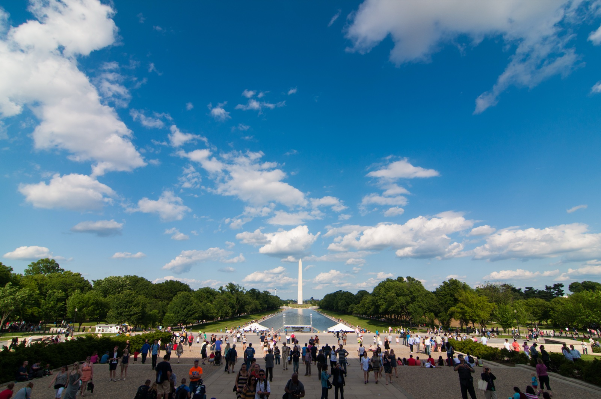
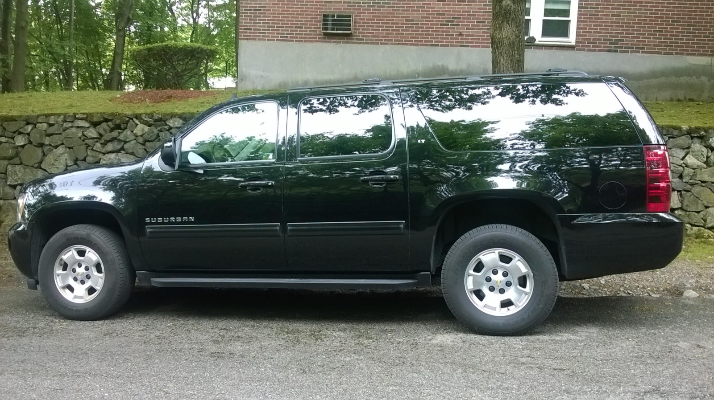

+++
title = "DC Visit"
date = 2014-06-01T09:04:00
description = "A Memorial Day weekend road trip from Boston to Washington, DC."
slug = "memorial"
aliases = ["memorial/"]
draft = false
[taxonomies]
tags = ["travel"]
[extra]
legacy_source = "memorial.rst"
+++

I recently visited Washington DC, the country's capital, with my wife and some friends. It was a three day visit over the Memorial day weekend. This was my second time in the capital. A combination of perfect weather and good company made this a memorable trip for us.

## Preparation

Travel: Our plan was to drive all the way to DC. On normal traffic it should take us around [8 hrs](https://www.waze.com/livemap?zoom=16&lat=38.90717&lon=-77.03888&from_lat=42.35843&from_lon=-71.05977&to_lat=38.90723&to_lon=-77.03646) to reach DC from Boston. We rented a car big enough to fit six people. We had three of us who could share the drive. Also we planned to use [Waze](https://www.waze.com) app and Garmin GPS with live traffic to keep our eye on traffic conditions ahead.

Lodging: We decided to try out [Airbnb](https://www.airbnb.com) for our stay in DC. After a couple of days of collaborative search we were able to find a host who would take in six guests. The host had good reviews from previous guests and the place was located behind the [US Naval Observatory](https://www.cnmoc.usff.navy.mil/usno/). So we felt pretty confident about the host and neighborhood.

## Day 0 (May 23, 2014)

The reservation for the rented car had a pick up time of 12 pm, but a call to customer service early in the morning confirmed that we could pick up the car earlier. So three of us who would be driving set off towards the Logan airport where the rental car was located. After a quick negotiation we were able to get a slightly bigger car (Chevy Suburban instead of Tahoe). In hindsight we are glad we made that choice. The Suburban was plenty spacious for six people and had enough luggage space too.

We drove back to our apartment where we loaded our luggage onto the car and by 12 pm we were on the road. Our plan was to head out by 12 pm so that we would reach DC by 9 pm in the evening. So we were pretty pleased with our organization. We took I-90 W all the way to Sturbridge and split off to I-84 to head down south. We were worried that we would hit New York City evening rush hour traffic.
