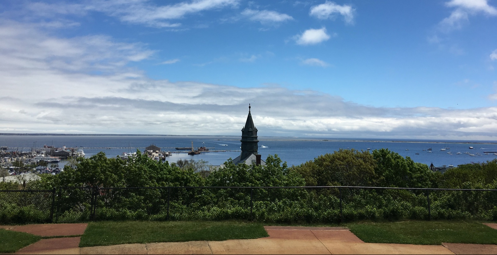
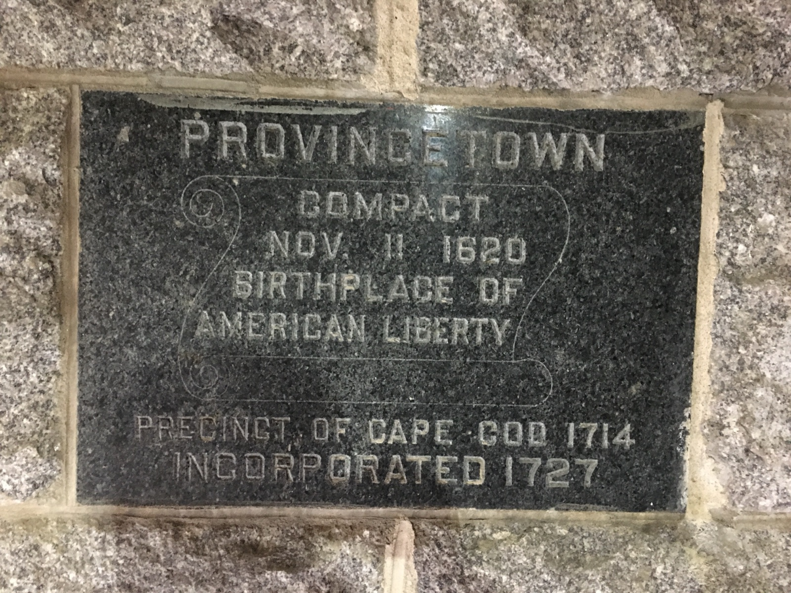
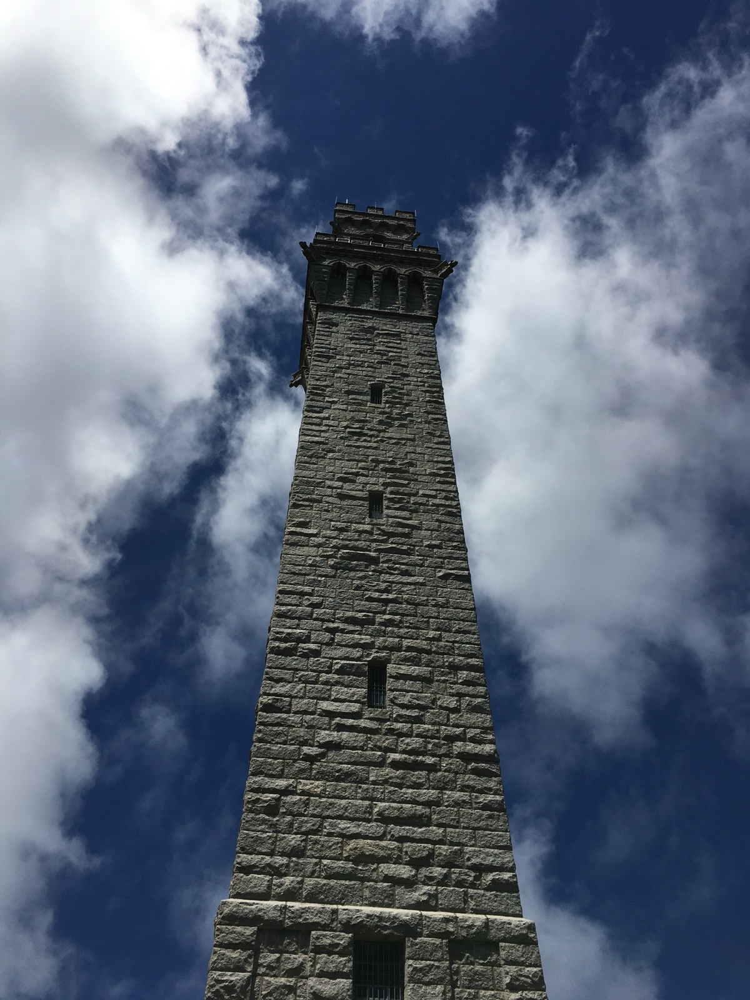
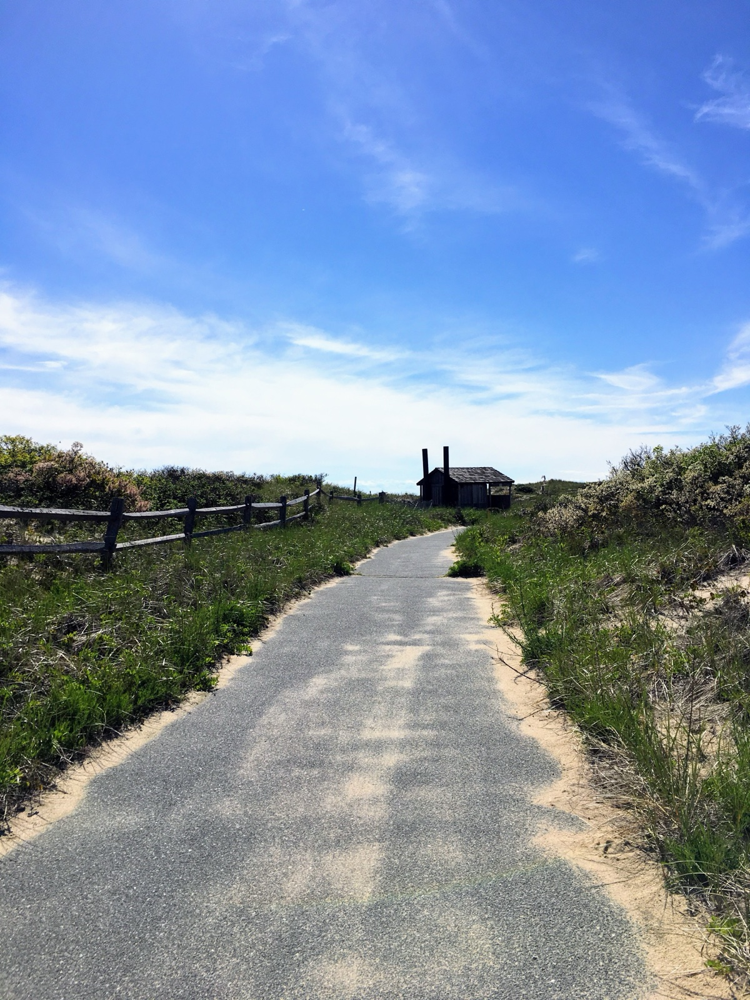
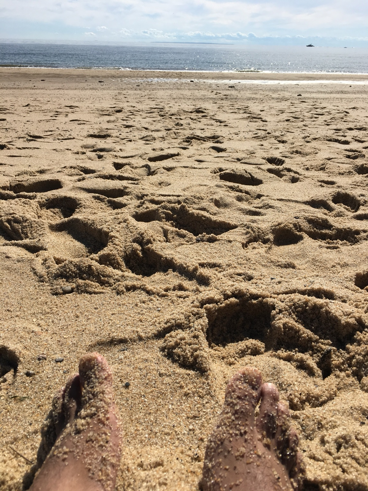
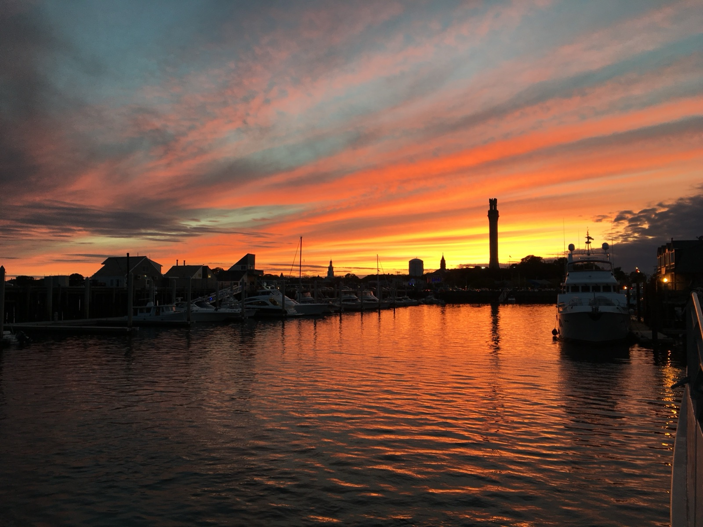

+++
title = "Provincetown visit"
date = 2017-06-03T10:14:00
description = "A ferry ride, a climb up Pilgrim Monument, and a day exploring Provincetown."
slug = "provincetown-visit"
aliases = ["provincetown-visit/"]
draft = false
[taxonomies]
tags = ["travel"]
[extra]
legacy_source = "provincetown-visit.rst"
+++

After living in [the Bay State](https://en.wikipedia.org/wiki/Massachusetts) for the last eight years, I finally visited the famed [Provincetown](https://en.wikipedia.org/wiki/Provincetown,_Massachusetts) during the Memorial day weekend. Provincetown (also locally called the P-town) is located at the tip of the Cape Cod region in Massachusetts. One can get to P-town either by driving via US Route 6 which goes all the way to the town. But during a busy weekend, you are highly likely to get stuck in heavy traffic before you can even enter the Cape Cod region. So in order to avoid the 'cape traffic', we decided to take a [ferry ride](http://www.bostonharborcruises.com/provincetown-ferry/) from Boston to Provincetown.

The Boston Harbor Cruises ferry ride was $88/person (roundtrip) and took about 90 minutes each way. The ferry leaves from Long Wharf in Boston. If you are planning to do a weekend one day trip to P-town (as we did) and are looking for parking, I strongly recommend the [Post Office Square parking garage](https://www.posquare.com). It is only about 10–15 minutes walk from the garage to Long Wharf and the weekend fare is only $9, which is significantly cheaper compared to other parking lots nearby. Our morning ferry was at 9 AM, so we arrived at the parking garage around 7:30 AM and had plenty of parking spots.

The ferry left Long Wharf sharp at 9 AM and arrived at Macmillan Wharf in Provincetown a little after 10:30 AM. A warning: during the first 30 minutes of the ferry ride out of Boston, the sea was rough enough to cause sea-sickness to several passengers including us. The ferry crew were giving out paper bags in case somebody threw up.

From Macmillan Wharf, it is a short walk to Commercial Street which is the main thoroughfare of the town. There are lots of shops along the street and tourists like us walking about. I was surprised by how narrow the street was, but it makes sense given the time when the town was established. We arrived early enough that there weren't too many people on the street (yet!), so walking around Commercial St was fun enough.

As you get off the ferry and walk towards the town, it is hard to miss the [Pilgrim Monument](https://www.pilgrim-monument.org) tower, which is the tallest structure in the town. We decided to visit the monument/museum where the entrance fee was $12/person. You can climb up the tower on foot. The climb is a combination of stairs and inclined flights. It must have taken us about 20 minutes to get to the top. But the views of the harbor and the town from the top are well worth the climb.

I also learnt that the monument was erected to mark the arrival of the [Pilgrims](https://en.wikipedia.org/wiki/Pilgrims_(Plymouth_Colony)), the early European settlers, in Provincetown in 1620. The common belief around is that the Pilgrims first made landfall in [Plymouth](https://en.wikipedia.org/wiki/Plymouth,_Massachusetts), Massachusetts. But it turns out that the Pilgrims actually landed in Provincetown and docked their ship, the Mayflower, in the harbor for a week before departing for Plymouth.

By the time we returned from the monument and went to Commercial St for lunch, the street was full of people. So after grabbing lunch, we ventured out of the town towards the shores. Crowd-filled Commercial St can feel a bit suffocating, but as you move away from downtown and approach the shores the cape surrenders its most intimate natural beauty to its visitors. The Cape Cod region has a distinct outlook due to its geography. I have noticed this 'capey feeling' every time I visited this region. The Provincetown shores were no different. It's rustic mixed with the constant sound of waves hitting the shores. All this is very relaxing.

We reached Herring Cove beach, which is about 1.5 miles west of downtown. The beach crowd was not there and the water was still freezing cold. But still the Sun was warm enough to enjoy the late afternoon basking. After spending about an hour in the Sun and walking along the shoreline we headed back to the hustle and bustle of Commercial St.

Our return ferry was scheduled for 8:30 PM and this time of the year the days are long and the Sun sets around that time. Just before our ferry departed, P-town treated us with this glorious sunset view leaving a lasting memory of the trip.

