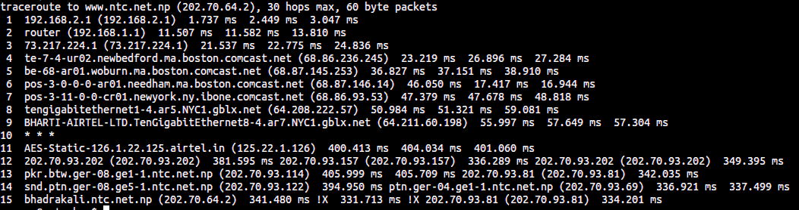

+++
title = "Traceroute to Nepal"
date = 2012-05-03T23:58:00
description = "Following packets from a US connection to Nepal Telecom through traceroute."
slug = "traceroute-to-nepal"
aliases = ["traceroute-to-nepal/"]
draft = false
[taxonomies]
tags = ["networking"]
[extra]
legacy_source = "traceroute-to-nepal.rst"
+++
traceroute is a wonderful tool to analyse network structure. According to its man page,

> traceroute tracks the route packets taken from an IP network on their way to a given host. It utilizes the IP protocol's time to live (TTL) field and attempts to elicit an ICMP TIME_EXCEEDED response from each gateway along the path to the host.

From time to time, I like to run my traceroute to explore how I connect to different websites via my ISP's network. It is especially interesting for me to do traceroute tests from US to servers hosted in Nepal, as I have some idea about how internet traffic flows in/out of Nepal. Today I'll present results on a traceroute test to Nepal Telecom's (NT) website. Since NT had optical fiber links through to India and beyond, it will be interesting to see which links are utilized for a packet to reach from US to NT.

## Analysis

- Hops 1–9, the packets are still in US.
- The trace starts from my router and goes into Comcast network and to BOS (Boston) in hop 4 and comes down to NYC (New York City) in hop 7 via routers at Woburn and Needham MA in hops 5 and 6 respectively.
- At NYC, the packet drops off from Comcast network to L3's 10 Gigabit ethernet links. Since NYC is the main landing site for Trans-Atlantic optical fiber cables coming ashore east coast in US, it is expected that the packet going out to Nepal would also follow the same path.
- From NYC, the next hop (9) is to Airtel in India via L3's 10Gigabit link.
- Among several telecom operators in India, NT has bought the largest bandwidth with Airtel, so it makes sense that the route via Airtel's network is the most viable one.
- At hop 11, the packet reached India. This is evident from the jump in round trip delay to ~400ms which translates to ~11,000 km. The fiber landing site is most likely Mumbai, India.
- From there on, the packet enters Nepal at hop 12. The router IP 202.70.x.x belongs to NT. The router at hop 12 is a Border Gateway router, most probably at Bhairahawa where most of NT connection goes through to India.
- The packet goes through Butwal to Pokhara (pkr.btw) in hop 13.
- From Pokhara, the packet reaches NT's Intn'l Exchange Bldg at Patan on hop 14. From there on the packet finally reaches the webserver at NT's central office at Bhadrakali.

This was a traceroute analysis through Comcast network. Next I'll do the same kind of analysis for a trace through Verizon DSL network.
